  <!-- Header Banner (Lavender & Purple Theme) -->
  

  <!-- Animated Typing SVG (Lavender Theme) -->
  

    

  <!-- Profile Quick Badges (Cohesive Lavender & Violet Theme) -->
  

    
    &nbsp;
    
    &nbsp;
    
  

  <!-- Profile Views Counter (Lavender Accent) -->
  

    
  

---

  <!-- Enhanced About Me Animated Headline Banner -->
  

    

  <!-- Identity & Role Badges Strip (Custom Lavender & Purple SVG) -->
  

    
  

  

    <i>"Blending technical precision with creative design to engineer digital experiences that matter."</i>
  

  

    Passionate about turning foundational engineering concepts into interactive, human-centered software. 
    <b>⚡ Experienced builder across 7+ Hackathons</b> — turning ambitious ideas into working prototypes with rapid execution. 
    Here is a snapshot of my core pillars, technical craft, and creative pursuits:
  

<table align="center" width="100%">
  <tr>
    <td width="50%" align="center" valign="top">
      
    </td>
    <td width="50%" align="center" valign="top">
      
    </td>
  </tr>
  <tr>
    <td width="50%" align="center" valign="top">
      
    </td>
    <td width="50%" align="center" valign="top">
      
    </td>
  </tr>
</table>

---

  <!-- Animated Tech Stack Headline Banner -->
  

    

  

    <i>"A curated set of technologies, frameworks, and creative design tools powering my projects."</i>
  

<table align="center" width="100%">
  <tr>
    <td width="50%" align="center" valign="top">
       
      
        
      

        
        
        
        
        
      

       
    </td>
    <td width="50%" align="center" valign="top">
       
      
        
      

        
        
        
      

      

        
      

       
    </td>
  </tr>
  <tr>
    <td width="50%" align="center" valign="top">
       
      
        
      

        
        
        
      

       
    </td>
    <td width="50%" align="center" valign="top">
       
      
        
      

        
        
        
      

       
    </td>
  </tr>
  <tr>
    <td width="50%" align="center" valign="top">
       
      
        
      

        
        
        
      

      

        
        
        
      

       
    </td>
    <td width="50%" align="center" valign="top">
       
      
        
      

        
        
        
        &nbsp;
        
      

      

        
      

       
    </td>
  </tr>
</table>

---

  

   
  
  &nbsp;
  
    
  

---

  

   
  

---

<!-- Footer Wave (Lavender & Purple Theme) -->

✦ Designed with creativity and purpose ✦

